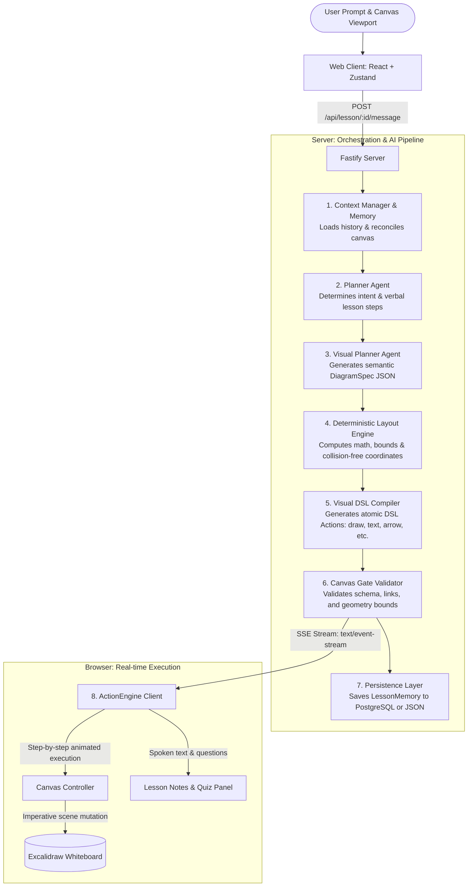
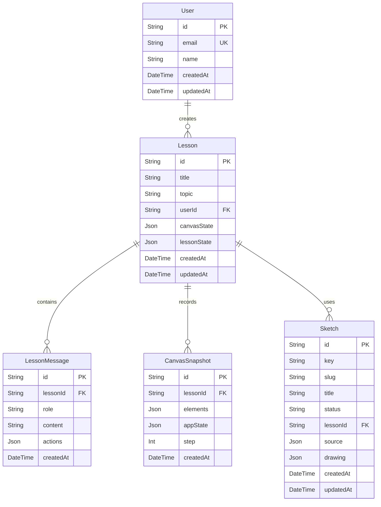

# ExcaliAI — System Architecture, Workflow & Viva Preparation Guide

---

## 1. Executive Summary & Project Objective

**ExcaliAI** is an **AI-powered interactive whiteboard tutor** built on top of **Excalidraw**, **Fastify**, **React**, and modern **Large Language Models (LLMs)**.

### The Problem
Traditional educational chatbots (like ChatGPT or Claude) explain concepts purely through walls of text or static markdown. When learning complex concepts—such as **Binary Search**, **TCP 3-Way Handshake**, **Transformer Self-Attention**, **Chemical Bonds**, or **Logic Circuits**—students need visual, step-by-step whiteboard drawings accompanied by synchronized explanations, just like a teacher at a blackboard.

### The ExcaliAI Solution
ExcaliAI bridges this gap:
1. **Hands-on Canvas Drawing:** An autonomous visual agent draws diagrams, algorithms, formulas, and freehand sketches on an Excalidraw canvas in real-time.
2. **Synchronized Socratic Narration:** The AI streams step-by-step explanations via **Server-Sent Events (SSE)**, pausing after each concept to ask checking questions.
3. **Robust Separation of Concerns:** The LLM is **never** allowed to write raw pixel coordinates. Instead, the AI generates a semantic **Visual DSL (Domain Specific Language)**, which a deterministic **Layout Engine** compiles into collision-free, styled Excalidraw scene elements.

---

## 2. High-Level System Architecture

The project is structured as a modular **Turborepo Monorepo**:

```
ExcaliAI/
├── apps/
│   ├── web/                     # Frontend Application (React 18 + Vite + Excalidraw)
│   │   ├── src/components/      # Canvas, Header, PromptBar, LessonPanel, Renderers
│   │   ├── src/engine/          # ActionEngine (animation) & CanvasController (Excalidraw API)
│   │   ├── src/services/        # SSE Streaming client & API handlers
│   │   └── src/store/           # Zustand state management (canvas & lesson turns)
│   └── server/                  # Backend Application (Fastify + TypeScript)
│       ├── src/agent/           # AI Multi-Agent Pipeline (TutorAgent, Planner, VisualPlanner)
│       ├── src/diagram/         # Deterministic Layout Engine, DSL Compiler & Canvas Gate
│       ├── src/sketch/          # Freehand sketcher & SVG vector extractor
│       ├── src/llm/             # Multi-Provider Gateway (Mistral, OpenRouter, OpenAI-compatible)
│       ├── src/storage/         # Dual Persistence Layer (Prisma ORM & JSON File fallback)
│       └── prisma/              # PostgreSQL schema definitions & migrations
└── packages/
    ├── shared/                  # Cross-boundary TypeScript contracts, SSE events, action schemas
    └── visual-dsl/              # AST grammar, validator, and visual primitives
```

---

## 3. End-to-End Workflow & Pipeline Diagram

The entire lifecycle from user prompt to live canvas animation follows a strict 8-stage pipeline:



### Detailed Pipeline Stages:
1. **Context Manager (`memory.ts`):** Fetches past conversation memory, verifies what elements currently exist on the user's canvas, and identifies diagrams to update or replace.
2. **Planner Agent (`PlannerAgent.ts`):** Evaluates user intent (new topic, continuation, modification, question) and drafts a pedagogical lesson plan.
3. **Visual Planner (`VisualPlannerAgent.ts`):** Translates educational steps into a high-level **DiagramSpec** (e.g. `nodes`, `connectors`, `labels`, `highlights`, `clusters`).
4. **Deterministic Layout Engine (`layout.ts`):** Calculates exact bounding boxes, auto-aligns elements horizontally/vertically, and calculates connector anchor points with zero overlap.
5. **DSL Compiler (`compiler.ts`):** Compiles the layout into executable atomic actions (`create_element`, `update_style`, `draw_arrow`, `render_formula`, `clear_region`).
6. **Canvas Gate (`canvasValidate.ts`):** A strict security & consistency barrier that prevents NaN coordinates, broken ID references, or out-of-bounds elements.
7. **SSE Streamer (`routes/lesson.ts`):** Emits events in real time:
   - `action`: Canvas drawing actions.
   - `step`: Narration text for the notes sidebar.
   - `ask`: Socratic checkpoint question for the student.
   - `done`: Turn completion signal.
8. **ActionEngine (`ActionEngine.ts`):** Receives the stream in the browser, queues actions, smoothly renders elements with animated delays, and updates Zustand state stores.

---

## 4. Database Architecture & Stored Information

ExcaliAI implements a **Dual-Persistence Layer**:
- **Primary:** **PostgreSQL** accessed through **Prisma ORM**.
- **Automatic Fallback:** **`FileLessonRepository`** storing JSON files in `.data/` if the database is offline or unconfigured.

### Entity Relationship Diagram



---

### Detailed Database Tables & Field Breakdown

#### 1. `User` (User Identity & Sessions)
*Stores authentication and profile information.*
- **`id`** (`String`, Primary Key, CUID): Unique identifier for the user.
- **`email`** (`String?`, Unique): User's email address.
- **`name`** (`String?`): Display name.
- **`createdAt` / `updatedAt`** (`DateTime`): Account creation and modification timestamps.
- **`lessons`** (Relation): One-to-many relationship with `Lesson`.

#### 2. `Lesson` (Central Lesson Session)
*Stores the state of an entire teaching session on a specific topic.*
- **`id`** (`String`, Primary Key, CUID / NanoID): Unique lesson session identifier.
- **`title`** (`String?`): Display title for the lesson (e.g., *"Understanding Binary Search"*).
- **`topic`** (`String`): The core subject or concept being taught.
- **`userId`** (`String?`, Foreign Key): Associated user (optional for guest sessions).
- **`canvasState`** (`Json?`): Blob of current Excalidraw scene elements, viewport position, and zoom levels.
- **`lessonState`** (`Json?`): **Single Source of Truth** for the AI agent memory (`LessonMemory`), including:
  - Active concept graph.
  - Previous turn conversation history.
  - Active diagram registry and element IDs for incremental updates.
- **`createdAt` / `updatedAt`** (`DateTime`): Session start and last interaction timestamps.

#### 3. `LessonMessage` (Turn-by-Turn Chat & Actions)
*Maintains the full conversation log and AI outputs.*
- **`id`** (`String`, Primary Key, CUID): Unique message identifier.
- **`lessonId`** (`String`, Foreign Key): Links message to parent `Lesson` (with `onDelete: Cascade`).
- **`role`** (`String`): Message sender (`"user"` | `"assistant"` | `"system"`).
- **`content`** (`String`): Raw text message (user prompt or AI text explanation).
- **`actions`** (`Json?`): Complete array of Visual DSL actions generated in this turn (assistant only). Used for undo/replay functionality.
- **`createdAt`** (`DateTime`): Timestamp of the interaction.

#### 4. `CanvasSnapshot` (Visual Checkpoint & Undo History)
*Enables rollback, revision, and historical visual timeline.*
- **`id`** (`String`, Primary Key, CUID): Snapshot identifier.
- **`lessonId`** (`String`, Foreign Key): Associated lesson.
- **`elements`** (`Json`): Complete Excalidraw elements array at this exact step.
- **`appState`** (`Json?`): Whiteboard configuration (zoom, scroll coordinates, selected tools).
- **`step`** (`Int`): Step sequence counter within the lesson.
- **`createdAt`** (`DateTime`): Timestamp when the snapshot was taken.

#### 5. `Sketch` (Vector Graphics & Freehand Templates)
*Stores custom drawings for topics without built-in primitives (e.g. biology structures, geography, hardware).*
- **`id`** (`String`, Primary Key): Unique sketch identifier.
- **`key`** (`String`, Indexed): Canonical search key (e.g. `"neuron"`, `"ear"`, `"transistor"`).
- **`slug`** (`String`): URL-friendly name.
- **`title`** (`String`): Human-readable title.
- **`status`** (`String`, Default: `"draft"`): `"draft"` (private to current lesson) or `"approved"` (promoted to global template library).
- **`lessonId`** (`String?`): Lesson that originally synthesized or imported the sketch.
- **`source`** (`Json`): Attribution metadata (`{ kind, credit, author, license, url }`).
- **`drawing`** (`Json`): Vector paths, parts, and coordinates matching the built-in Excalidraw template format.
- **`createdAt` / `updatedAt`** (`DateTime`): Creation and modification timestamps.

---

## 5. Key Technologies & Justification

| Technology | Role | Why It Was Chosen |
| :--- | :--- | :--- |
| **Turborepo** | Monorepo Build System | Fast caching, single package installation, shared TypeScript contracts between frontend and backend. |
| **Fastify** | Backend Web Framework | 2x-4x faster throughput than Express, native asynchronous hooks, and optimal support for SSE stream hijacking. |
| **Excalidraw** | Whiteboard Engine | Industry standard hand-drawn aesthetic, lightweight JSON format, rich canvas APIs for programmatic element insertion. |
| **Server-Sent Events (SSE)** | Real-Time Transport | Unidirectional streaming fits generative AI outputs perfectly without the overhead or connection complexity of full WebSockets. |
| **Prisma ORM** | Data Access Layer | Type-safe queries, automatic migration generation, and clean relational modelling with PostgreSQL. |
| **Zustand** | Frontend State Management | Lightweight, hook-based, zero boilerplate compared to Redux; ideal for handling canvas sync and lesson states. |
| **Visual DSL & Layout Engine** | Drawing Reliability | Completely eliminates LLM spatial hallucinations. The LLM specifies *what* to draw, while deterministic algorithms calculate *where* to place it. |

---

## 6. Viva Questions & Model Answers

### Q1: Why not let the LLM generate Excalidraw coordinates directly?
> **Answer:** LLMs are autoregressive token predictors and are notoriously bad at precise 2D spatial reasoning. If an LLM directly generates $(x, y)$ coordinates, elements frequently overlap, arrows misalign, text overflows boundaries, and the canvas looks chaotic. ExcaliAI uses a **two-tier architecture**: the LLM outputs a semantic `DiagramSpec` (relationships and node hierarchy), and our deterministic **Layout Engine** algorithmically computes collision-free coordinates, padding, and alignments.

### Q2: Why did you choose Server-Sent Events (SSE) instead of WebSockets?
> **Answer:** The communication model in AI lesson generation is strictly **unidirectional streaming** (the user submits a prompt, and the server streams back dozens of actions and explanations over a few seconds). SSE operates over standard HTTP, supports automatic reconnection, works seamlessly with corporate firewalls/proxies, has no handshake overhead, and avoids the stateful connection-pooling overhead of full-duplex WebSockets.

### Q3: What happens if PostgreSQL goes down or is not installed?
> **Answer:** ExcaliAI includes an automatic repository abstraction (`LessonRepository`). At server startup, `checkDatabaseConnection()` verifies PostgreSQL health. If PostgreSQL is unavailable, the server seamlessly switches to `FileLessonRepository`, storing and loading sessions as atomic JSON files inside `.data/`. The user experience remains uninterrupted.

### Q4: How does the system handle "Undo" or rolling back an AI turn?
> **Answer:** Each lesson turn stores an undo delta in `LessonMemory` and takes a `CanvasSnapshot`. When the user clicks "Undo", `POST /api/lesson/:id/undo` retrieves the previous state, computes the negative diff (elements to delete or restore), and sends back inverse DSL actions to immediately restore the canvas and agent context to the previous turn.

### Q5: How do you support multiple LLM providers (Mistral, OpenRouter, OpenAI)?
> **Answer:** We implemented an **AIGateway** abstraction with a unified provider router (`apps/server/src/llm/router.ts`). It normalizes system prompts, enforces schema validation with Zod, redacts API keys from logs, and automatically falls back to alternative models or mock fixtures if rate limits or network errors occur.
